# دليل المستخدم: رحلة مريض كاملة في UNITECH-EHR

> **مسودة أولى.** الدليل مبني على رحلة حقيقية نُفّذت على **بيئة التدريب** لمريض باسم **محمد سميح**: من الاستقبال حتى أرشفة السجل الطبي. كل لقطة شاشة مأخوذة من تلك الرحلة، وكل خطوة نفّذها حساب الدور الذي يقوم بها في المستشفى.
>
> البيانات وهمية. لا تُستخدم أسماء أو أرقام مرضى حقيقيين في بيئة التدريب.

## المريض والزيارة

| | |
|---|---|
| المريض | محمد سميح (Mohammad Sameeh)، ذكر، مواليد 1984-03-14 |
| الرقم الوطني | 9990000201 (رقم وهمي للتدريب) |
| رقم الملف الطبي (MRN) | HOSP-01-000114 |
| الزيارة | VIS-2026-4DAF79CA، عيادة الباطنية، نقدي |
| الشكوى | التهاب حلق وحرارة منذ يومين |
| التشخيص | التهاب البلعوم الحاد (J02.9) |
| الفحوص | خضاب الدم (Hemoglobin)، وصورة صدر بالأشعة |
| العلاج | باراسيتامول 500 ملغ كل 8 ساعات لمدة 3 أيام |
| الفاتورة | INV-C79BAE61: ‏57.5 دينار أردني، مدفوعة نقداً |
| نتيجة الرحلة | 100% من المراحل الإلزامية لمسار العيادات |

## من يفعل ماذا

| # | المرحلة | الدور (حساب التدريب) | الشاشة |
|---|---|---|---|
| 1 | البحث عن المريض وتسجيله | الاستقبال (`train.receptionist`) | Patient Registry، Register Patient |
| 2 | الموعد وتسجيل الوصول، فتُفتح الزيارة | الاستقبال | Appointments |
| 3 | تصنيف الزيارة: نقدي | المحاسبة (`train.cashier`) | Billing & Claims |
| 4 | الفرز والعلامات الحيوية | التمريض (`train.nurse`) | Clinical Workspace ← الزيارة ← Vitals |
| 5 | التشخيص، والملاحظة الموقّعة، والوصفة، وطلب الفحوص | الطبيب (`train.doctor`) | Clinical Workspace ← الزيارة |
| 6 | العيّنة، والنتيجة، والاعتماد الفني | فني المختبر (`train.lab.technician`) | Laboratory |
| 7 | الاعتماد السريري والتقرير النهائي | مشرف المختبر (`train.lab.supervisor`) | Laboratory |
| 8 | سير فحص الأشعة والصور | فني الأشعة (`train.radiology.technician`) | Radiology & PACS |
| 9 | تقرير الأشعة النهائي | أخصائي الأشعة (`train.radiologist`) | Radiology & PACS |
| 10 | تدقيق الوصفة وصرفها | الصيدلي (`train.pharmacist`) | Pharmacy Operations |
| 11 | مراجعة النتائج، وإنهاء الزيارة | الطبيب | Clinical Workspace ← الزيارة |
| 12 | موعد المتابعة | الاستقبال | Appointments |
| 13 | الرسوم، والفاتورة، والدفع | المحاسبة | Billing & Claims |
| 14 | مراجعة السجل، والتوقيع، والقفل، والأرشفة | السجلات الطبية (`train.medical.records`) | Medical Records / HIM |
| — | قائمة الأسعار (إعداد مسبق) | الإدارة (`train.administrator`) | Administration ← Price Lists |

---

## 0. الدخول

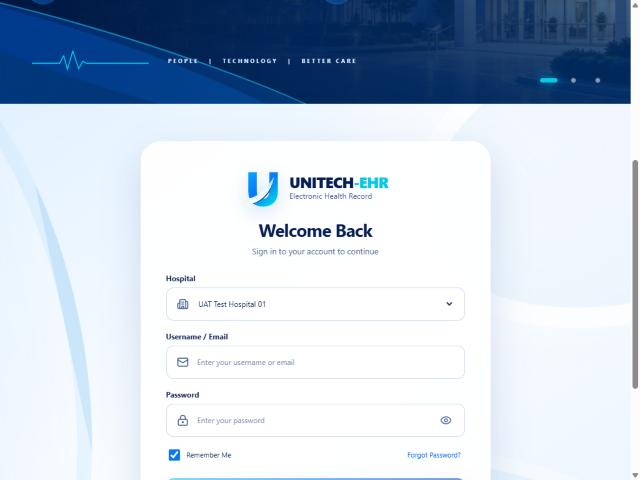

1. اختر **المستشفى** من القائمة.
2. أدخل **اسم المستخدم** (مثل `train.receptionist`) وكلمة المرور.
3. اضغط **Sign In**.

تظهر في القائمة الجانبية الشاشات المسموحة لدورك فقط. بعد خمس محاولات دخول فاشلة يُقفل الحساب مؤقتاً.

---

## 1. الاستقبال: البحث عن المريض قبل تسجيله

**الحساب:** `train.receptionist` · **الشاشة:** Patient Registry

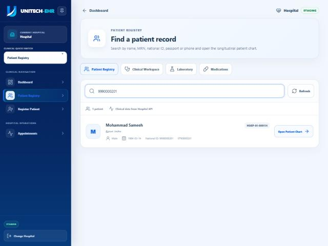

1. من القائمة الجانبية اختر **Patient Registry**.
2. اكتب في مربع البحث الاسم، أو رقم الملف، أو الرقم الوطني، أو الجواز، أو الهاتف. هنا كُتب الرقم الوطني `9990000201`.
3. تظهر النتيجة مع رقم الملف (`HOSP-01-000114`) وتاريخ الميلاد والهاتف.

ابحث دائماً قبل التسجيل، فالمريض قد يكون مسجلاً من قبل. البحث يتم في الخادم وضمن المستشفى المختارة فقط.

## 2. الاستقبال: تسجيل مريض جديد

**الشاشة:** Register Patient

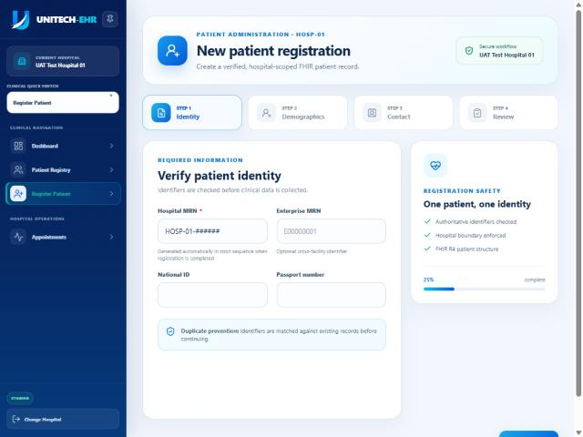

التسجيل من أربع خطوات:

1. **Identity:** الرقم الوطني أو الجواز. رقم الملف (Hospital MRN) يُنشأ تلقائياً.
2. **Demographics:** الاسم بالعربية والإنجليزية، والجنس، وتاريخ الميلاد.
3. **Contact:** الهاتف والعنوان.
4. **Review:** مراجعة البيانات وتأكيدها.

النظام يفحص التكرار بالرقم الوطني والجواز والهاتف، ويمنع تسجيل المريض مرتين.

## 3. الاستقبال: حجز الموعد وتسجيل الوصول، وبه تُفتح الزيارة

**الشاشة:** Appointments

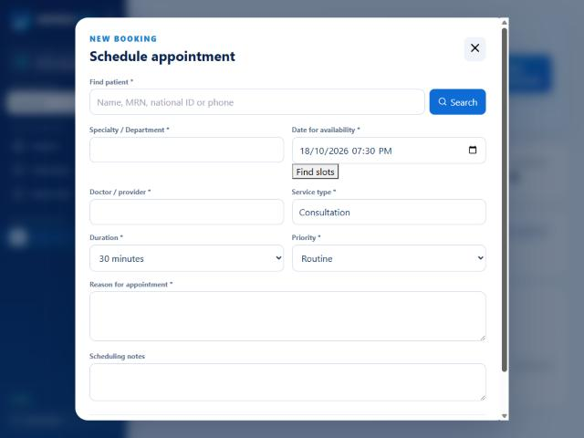

1. اضغط **New appointment**.
2. **Find patient:** ابحث عن محمد سميح واختره.
3. اختر **Specialty / Department** (Internal Medicine) والطبيب (**Doctor / provider**)، والتاريخ والمدة ونوع الخدمة والأولوية.
4. اكتب **Reason for appointment**: "Sore throat and fever for two days"، ثم احفظ.

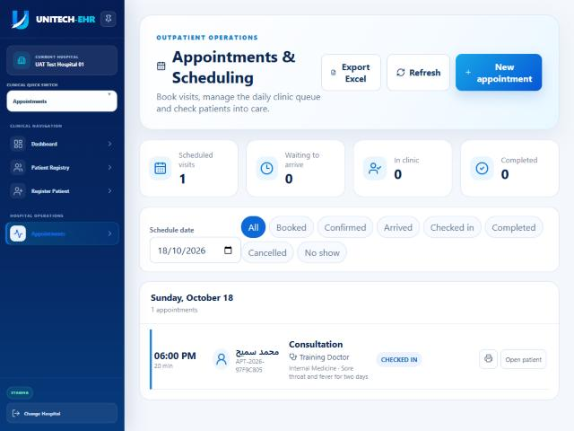

5. عند وصول المريض، غيّر حالة الموعد إلى **Arrived**، ثم اضغط **Check in & create encounter**. هذه الخطوة تفتح زيارة العيادة تلقائياً (VIS-2026-4DAF79CA)، ويظهر الموعد بحالة **CHECKED IN**.

الاستقبال لا يفتح الزيارة مباشرة، بل عن طريق تسجيل الوصول على موعد. المريض الذي يصل بلا موعد يُحجز له موعد فوري بالطريقة نفسها.

## 4. المحاسبة: تصنيف الزيارة

**الحساب:** `train.cashier` · **الشاشة:** Billing & Claims

تصنيف الزيارة (نقدي أو تأمين) من صلاحية المحاسبة أو مسؤول التأمين، لا الاستقبال. صُنّفت زيارة محمد سميح **نقدي (cash)**. هذا التصنيف يكمل مرحلة **Insurance / Payer** في رحلة المريض.

---

## 5. التمريض: الفرز والعلامات الحيوية

**الحساب:** `train.nurse` · **الشاشة:** Clinical Workspace ← زيارة المريض

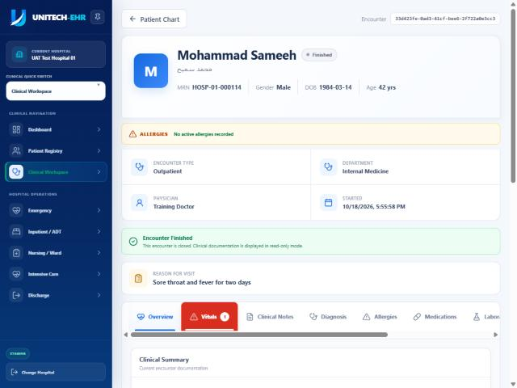

يعرض رأس الزيارة اسم المريض ورقم ملفه وعمره، وتنبيهات الحساسية، ونوع الزيارة والقسم والطبيب، وسبب الزيارة. وتحته تبويبات الزيارة: **Overview**، و**Vitals**، و**Clinical Notes**، و**Diagnosis**، و**Allergies**، و**Medications**، و**Laboratory**، و**Radiology**، و**Patient Journey**.

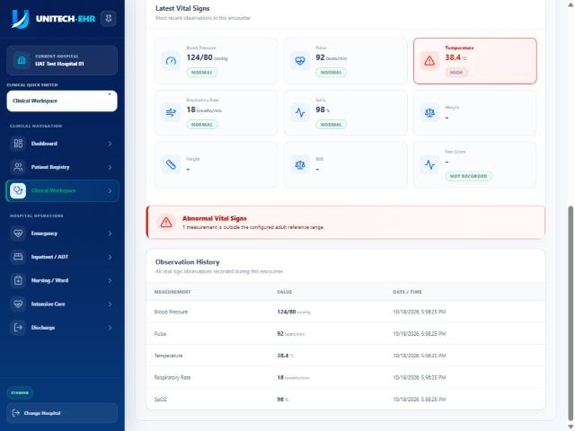

1. افتح تبويب **Vitals**، ثم **Record Vital Signs**.
2. أدخل ضغط الدم والنبض والحرارة والتنفس والأكسجين، ومستوى الفرز، والشكوى الرئيسية.
3. راجع الحساسية والأدوية الحالية، وأكّد الفرز، ثم **Save Vitals**.

القيمة خارج المدى الطبيعي تُعلَّم تلقائياً، كالحرارة 38.4 °C هنا (HIGH)، ويظهر تنبيه **Abnormal Vital Signs**.

---

## 6. الطبيب: التشخيص والملاحظة والوصفة والطلبات

**الحساب:** `train.doctor` · **الشاشة:** Clinical Workspace ← زيارة المريض

### التشخيص

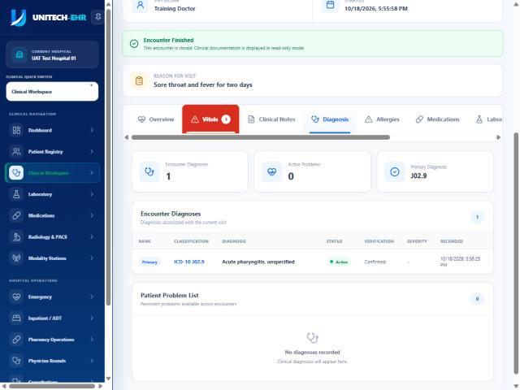

**Diagnosis ← Add Diagnosis:** اختر نظام التصنيف (ICD-10)، والرمز J02.9 (Acute pharyngitis)، والرتبة **Primary**، وحالة التحقق **Confirmed**.

### الملاحظة السريرية الموقّعة

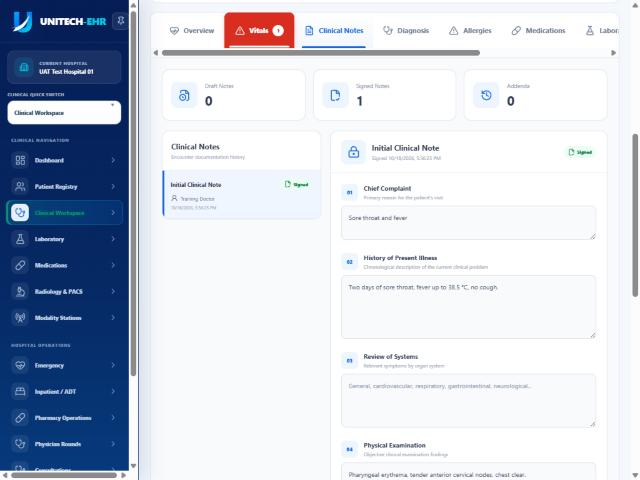

في **Clinical Notes** املأ أقسام الملاحظة: الشكوى، والقصة المرضية، والفحص السريري، والتقييم، والخطة. ثم اضغط **Sign Note**. الملاحظة الموقّعة لا تُعدَّل، وأي إضافة بعدها تكون **Addendum**.

> لا يمكن إنهاء الزيارة دون تشخيص وملاحظة موقّعة.

### الوصفة

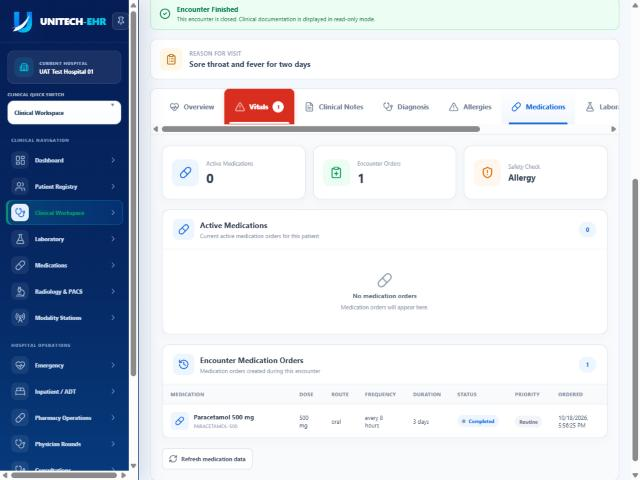

**Medications ← New Medication Order:** باراسيتامول 500 ملغ، فموي، كل 8 ساعات لمدة 3 أيام، الكمية 9 أقراص. يفحص النظام الحساسية قبل الحفظ ويعرض تنبيهاً إن وُجدت.

### طلب المختبر والأشعة

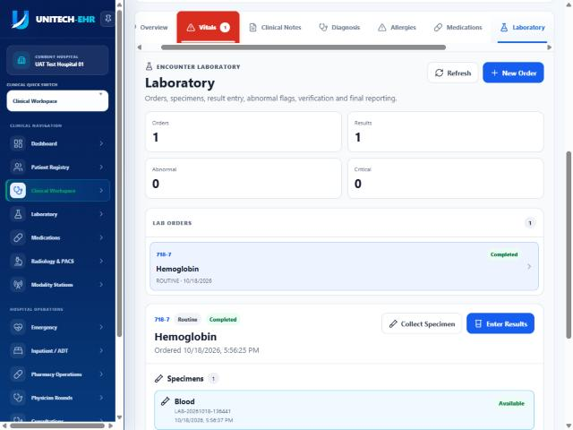

- **Laboratory ← New Order:** خضاب الدم (Hemoglobin، 718-7)، روتيني.
- **Radiology ← طلب جديد:** صورة صدر (Chest X-ray، 36643-5)، مع السبب السريري "Fever, exclude pneumonia".

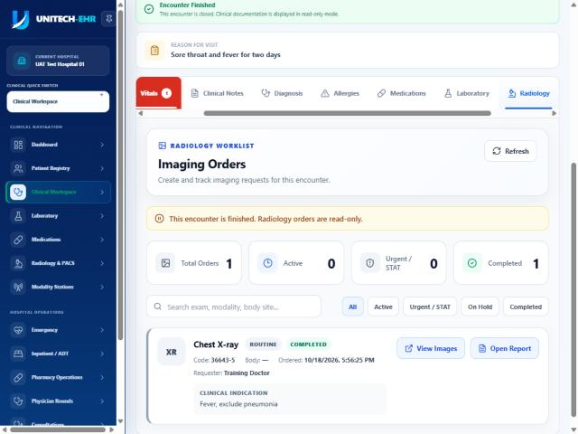

---

## 7. المختبر: العيّنة والنتيجة والاعتماد

**الحسابات:** `train.lab.technician` ثم `train.lab.supervisor` · **الشاشة:** Laboratory

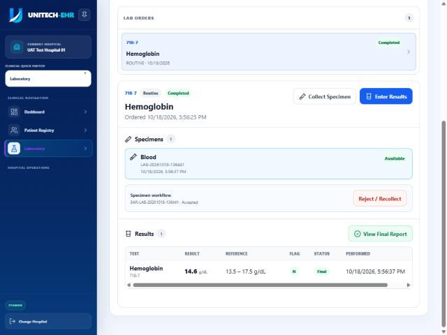

1. **Collect Specimen:** سجّل جمع عيّنة الدم.
2. استلم العيّنة في المختبر واقبلها. العيّنة غير الصالحة تُرفض بسبب عبر **Reject / Recollect**، مع طلب إعادة جمعها.
3. **Enter Results:** أدخل القيمة 14.6 g/dL، والمدى الطبيعي 13.5–17.5. تُعلَّم القيمة خارج المدى تلقائياً (H أو L، والحرجة HH أو LL).
4. **الاعتماد الفني:** بحساب الفني.
5. **الاعتماد السريري:** بحساب المشرف. لا يُعتمد سريرياً قبل الاعتماد الفني.
6. المشرف ينشئ التقرير ويعتمده نهائياً، ثم يُعرض عبر **View Final Report**.

النتيجة الأولية لا تُعدّ نهائية. يرى الطبيب النتيجة نهائية بعد التقرير النهائي فقط.

---

## 8. الأشعة: سير الفحص والصور والتقرير

**الحسابات:** `train.radiology.technician` ثم `train.radiologist` · **الشاشة:** Radiology & PACS

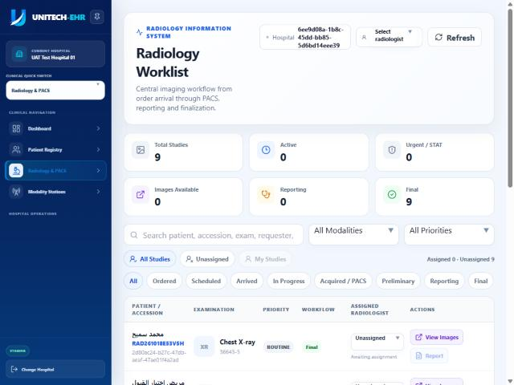

1. يجد الفني الطلب في **Radiology Worklist** ويحرّكه عبر حالاته: مجدول، ثم المريض وصل، ثم الفحص بدأ، ثم الصور التُقطت.
2. يرسل جهاز التصوير الصور إلى PACS. عندما تربط المزامنة الدراسة بالطلب، تصبح حالة **Images Available** ممكنة.

   النظام **يرفض** "الصور متاحة" والتقرير النهائي قبل أن تصل الدراسة فعلاً إلى PACS.
3. يمكن فتح الصور من **View Images**. يرى كل مستخدم دراسات مستشفاه فقط.
4. يكتب أخصائي الأشعة التقرير (Technique، وFindings، وImpression) ثم **Finalize Report**.

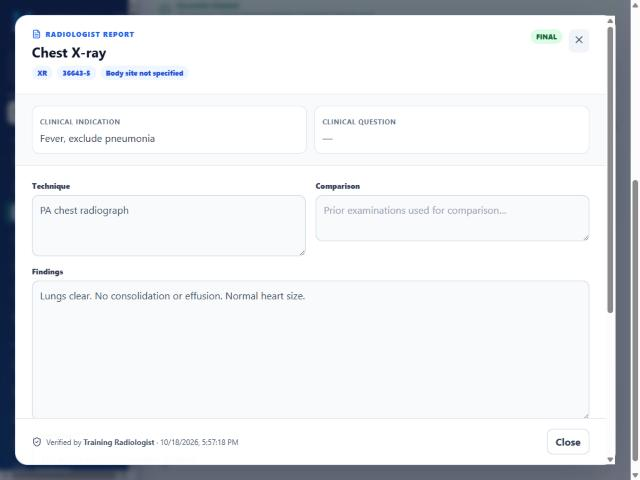

---

## 9. الصيدلية: تدقيق الوصفة وصرفها

**الحساب:** `train.pharmacist` · **الشاشة:** Pharmacy Operations

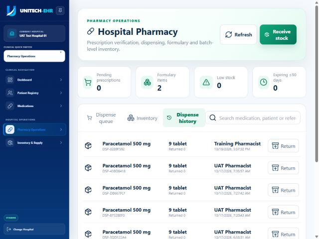

1. **Receive stock:** استلام مخزون الدواء مع رقم التشغيلة وتاريخ الانتهاء.
2. من **Dispense queue** افتح وصفة محمد سميح. راجع الحساسية والتداخلات والجرعة والمخزون، وأكّد التدقيق.
3. **Dispense:** صرف 9 أقراص، مع تأكيد **Patient counseling completed**.
4. تظهر العملية في **Dispense history** باسم الصيدلي.

لا صرف قبل تدقيق الوصفة، ولا صرف من مخزون غير كافٍ.

---

## 10. الطبيب: مراجعة النتائج وإنهاء الزيارة

1. يراجع الطبيب تقرير المختبر وتقرير الأشعة النهائيين، ويسجّل الإقرار (acknowledged). النتيجة الحرجة تتطلب ملاحظة إلزامية.
2. من نافذة إنهاء الزيارة يختار **Discharge home**، وحالة المريض **Improved**، وتعليمات الخروج، و**Follow-up date** بعد أسبوع. ثم يضغط **Finish encounter safely**.

بعد الإنهاء يصبح توثيق الزيارة للقراءة فقط (**Encounter Finished**، كما في رأس الزيارة أعلاه).

## 11. الاستقبال: موعد المتابعة

يحجز الاستقبال موعد متابعة بعد أسبوع مع طبيب الباطنية، بالسبب "Follow-up after acute pharyngitis"، من **New appointment** كما في الخطوة 3.

---

## 12. المحاسبة: الرسوم والفاتورة والدفع

**الحساب:** `train.cashier` · **الشاشة:** Billing & Claims (أو زر **Billing** في ملف المريض لمن لديه صلاحية المحاسبة)

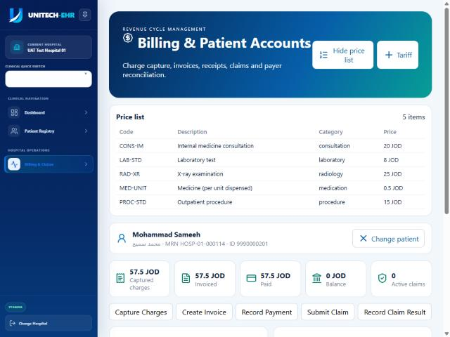

1. ابحث عن المريض بالاسم أو رقم الملف أو الرقم الوطني، أو افتح الشاشة من ملفه.
2. **Price list:** تعرض الأسعار المعتمدة بالدينار الأردني. تُدار من Administration ← Price Lists، وكل سعر له فئة (استشارة، مختبر، أشعة، دواء، إجراء).
3. **Capture charges:** اختر الزيارة من القائمة، فتُحسب الرسوم من قائمة الأسعار تلقائياً.

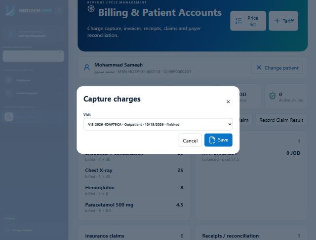

4. **Create invoice:** اختر الزيارة وأنشئ الفاتورة.
5. **Record payment:** اختر الفاتورة (المبلغ المتبقي يُعبّأ تلقائياً)، وطريقة الدفع **Cash**، ورقم الإيصال.

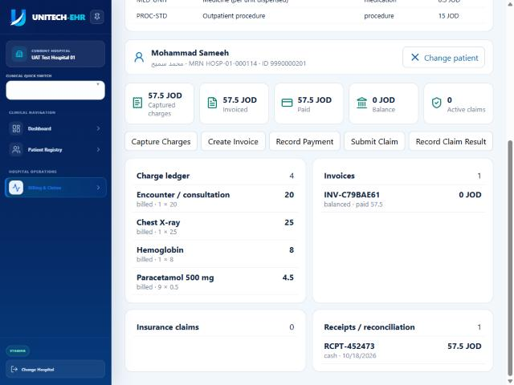

| البند | الحساب | المبلغ (دينار) |
|---|---|---|
| Encounter / consultation | 1 × 20 | 20 |
| Chest X-ray | 1 × 25 | 25 |
| Hemoglobin | 1 × 8 | 8 |
| Paracetamol 500 mg | 9 × 0.5 | 4.5 |
| **المجموع** | | **57.5، مدفوع، الرصيد 0** |

لمريض التأمين: **Submit claim** (اختر الفاتورة والتغطية الفعّالة)، ثم **Record claim result** عند وصول رد الجهة. سبب الرفض أو التخفيض مطلوب فقط إن لم تُقبل المطالبة كاملة.

---

## 13. السجلات الطبية: المراجعة والتوقيع والقفل والأرشفة

**الحساب:** `train.medical.records` · **الشاشة:** Medical Records / HIM

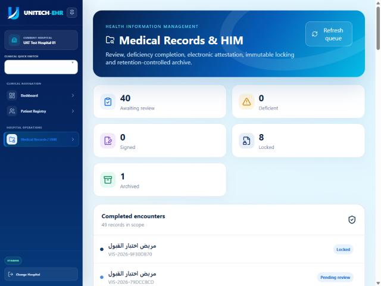

1. اختر الزيارة من **Completed encounters**.
2. **Run record review:** يفحص النظام النواقص، مثل ملاحظة غير موقّعة أو تشخيص ناقص. كل نقص يُغلق بـ **Resolve** مع ذكر الحل.
3. **Sign & finalize:** توقيع السجل وإغلاقه. لا يُغلق السجل مع نواقص مفتوحة، ولا قبل إنهاء الزيارة.
4. **Lock record:** قفل السجل. بعد القفل لا يُعدَّل إلا بتعديل مسبب يُحفظ معه الأصل.
5. **Archive:** الأرشفة مع تاريخ نهاية الاحتفاظ.

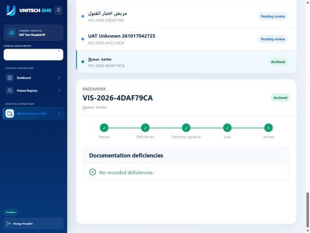

---

## 14. متابعة الرحلة كاملة

**الشاشة:** زيارة المريض ← تبويب **Patient Journey** (لمن لديه الصلاحية السريرية)

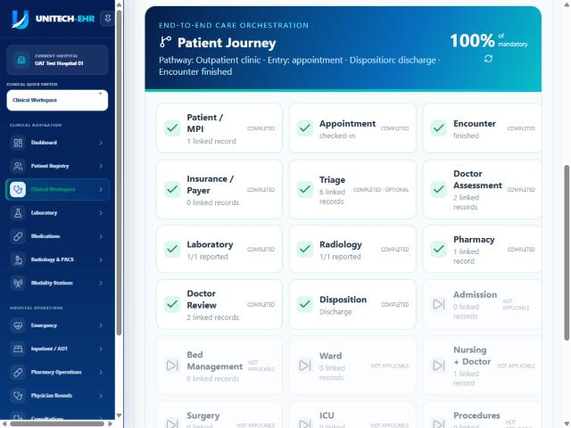

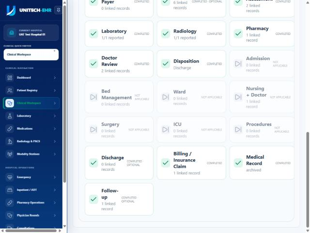

- كل مرحلة تظهر بإحدى الحالات: مكتملة، أو حالية، أو معلّقة، أو **اختيارية**، أو غير منطبقة.
- **المراحل الإلزامية** تحددها المستشفى لكل نوع زيارة، من Administration ← Care Pathways.
- النسبة (**100% of mandatory**) تُحسب على المراحل الإلزامية فقط.
- في رحلة محمد سميح اكتملت كل المراحل المنطبقة، ومنها الفرز والمتابعة الاختياريتان. أما مراحل التنويم والعمليات والعناية المركزة فلا تنطبق على زيارة عيادة.

---

## ملحق: قائمة الأسعار (إعداد مسبق)

**الحساب:** `train.administrator` · **الشاشة:** Administration ← Price Lists

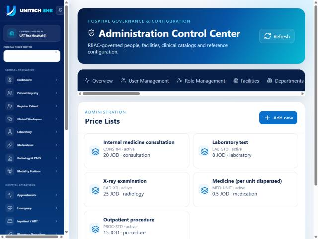

لإضافة سعر: **Add new**، ثم أدخل الاسم والرمز والسعر و**Billing category**. الأسعار المضافة هنا تظهر في Billing وتُستخدم في التقاط الرسوم. العملة الافتراضية للنظام هي الدينار الأردني.

## ملاحظات معروفة في هذه المسودة

- **فتح الملف من الاستقبال:** سجل المرضى يعرض للاستقبال زر **Open Patient Chart**، لكن ملف المريض يتطلب الصلاحية السريرية، فلا يفتح لحساب الاستقبال. عمل الاستقبال يتم من Patient Registry وRegister Patient وAppointments.
- **شاشة الأشعة:** حقل المستشفى في Radiology Worklist يعرض المعرّف الداخلي بدل اسم المستشفى.
- **لقطات الشاشة:** أُخذت بالواجهة الإنجليزية لأن أسماء الشاشات والأزرار بالإنجليزية.

## إعادة إنتاج هذه الرحلة

على بيئة تدريب سبقت تهيئتها بـ `seed-training.mjs`:

```bash
cd services/hospital-api
DEMO_ORTHANC_CONTAINER=<orthanc container> DEMO_ORTHANC_PASSWORD_FILE=<orthanc password file> \
  node --env-file=<seed.env> scripts/demo-journey.mjs --training-environment
```

ينفّذ السكربت الخطوات الثلاثين نفسها بحسابات الأدوار، ويتحقق أن الرحلة 100% وأن الفاتورة مدفوعة.
